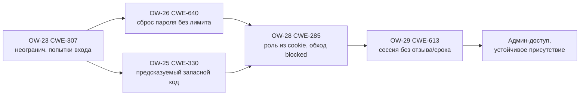
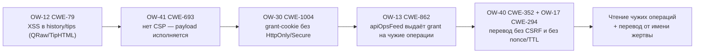
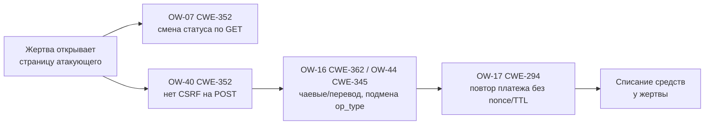
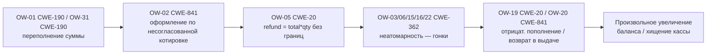
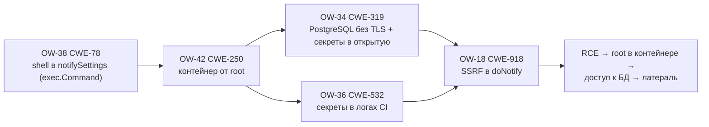

# Office Wallet — Цепочки уязвимостей

| # | Цель | Ключевые звенья | Итоговый импакт |
|---|------|-----------------|-----------------|
| 1 | Захват аккаунта → админ | OW-23 → OW-25/OW-26 → OW-28 → OW-29 | Админ-доступ + устойчивое присутствие |
| 2 | XSS → кража grant → чужие операции | OW-12 → OW-41 → OW-30 → OW-13 → OW-40/OW-17 | Чтение чужих финопераций + перевод от жертвы |
| 3 | CSRF-списание без XSS | OW-07 → OW-40 → OW-16/OW-44 → OW-17 | Списание средств у жертвы |
| 4 | «Бесконечные деньги» | OW-01/OW-31 → OW-02 → OW-05 → OW-03/OW-06 → OW-19/OW-20 | Произвольное увеличение баланса / хищение кассы |
| 5 | RCE → контейнер → БД | OW-38 → OW-42 → OW-34/OW-36 → OW-18 | RCE, root в контейнере, доступ к БД, латераль |

---

## Цепочка 1 — Захват аккаунта и эскалация до администратора

Атакующий сначала получает чужую учётку, затем превращает обычного пользователя
в администратора и закрепляется так, что блокировка его не выбивает.

Входная точка — брутфорс (`login` без rate-limit, OW-23), который усиливается подбором
токена сброса пароля (OW-26) и предсказуемым запасным OTP при сбое `crypto/rand` (OW-25).
Дальше решающее звено — OW-28: роль берётся из cookie, а флаг `blocked` в сессии не
проверяется, поэтому роль поднимается до `admin` и блокировка обходится. OW-29 (сессии
без срока и отзыва) закрепляет доступ. Отсюда открываются OW-37 (`/ops/journal` без ролей),
OW-10/OW-39 (внутренние цены и supply-канал). OW-27 закрыт, общий ящик уже недоступен.

## Цепочка 2 — XSS → кража grant → доступ к чужим операциям → перевод

Атакующий заливает HTML-payload через перевод или чаевые (OW-12, небезопасный
`QRaw`/`TipHTML`). Отсутствие CSP (OW-41) даёт ему исполниться у жертвы. Так как
grant-cookie не помечена `HttpOnly`/`Secure` (OW-30), скрипт её читает, а `apiOpsFeed`
выдаёт grant и на чужие операции (OW-13) — это доступ к чужой финансовой истории.
Завершается переводом денег от имени жертвы через отсутствие CSRF (OW-40) и повтор
платежа без nonce/TTL (OW-17).

## Цепочка 3 — Списание средств через CSRF без XSS

Вариант цепочки 2 без необходимости XSS. Достаточно заманить залогиненную жертву на
свою страницу: GET-эндпоинты меняют состояние (OW-07), POST-формы не защищены
CSRF-токеном/Origin (OW-40), а `op_type` можно подменить при подтверждении перевода
(OW-44). Повтор платежа (OW-17) позволяет множить списание.

## Цепочка 4 — «Бесконечные деньги» (нарушение финансовой целостности)

Начало — арифметическое переполнение при расчёте покупки или конвертации рублей в
копейки (OW-01, OW-31). Оформление берёт сумму из котировки, а позиции из живой
корзины (OW-02), возврат считается как `total * qty` без границ (OW-05). Неатомарность
операций (OW-03, OW-06, OW-15, OW-16, OW-22) позволяет гонками задвоить возврат или
списание, а отрицательное кассовое пополнение (OW-19) и возврат денег в обработчике
выдачи (OW-20) замыкают схему на бесконтрольный рост баланса. OW-11 (неактивные товары,
ложный успех корзины) помогает собрать нужную корзину.

## Цепочка 5 — RCE → компрометация контейнера → БД и латеральное движение

Главный открытый путь к RCE сейчас — OW-38: `exec.Command` в обработчике настроек
уведомлений (OW-08 с command injection в превью уже закрыт). Контейнер работает от root
(OW-42), поэтому выполнение команд сразу привилегированное. Отсюда — доступ к кредам
PostgreSQL, которые идут без TLS и хранятся открыто (OW-34), плюс секреты, утёкшие в
логи CI (OW-36). SSRF в `doNotify` (OW-18) расширяет досягаемость до внутренних сервисов
(notify-mock, метаданные). По всем звеньям recon облегчает OW-43 (ошибки БД в ответах
клиенту).
